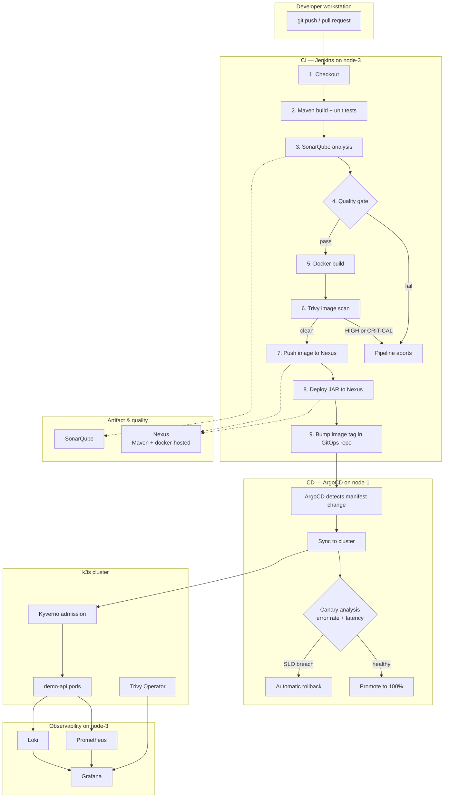
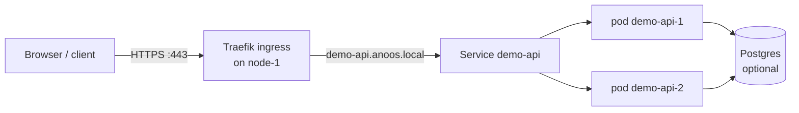
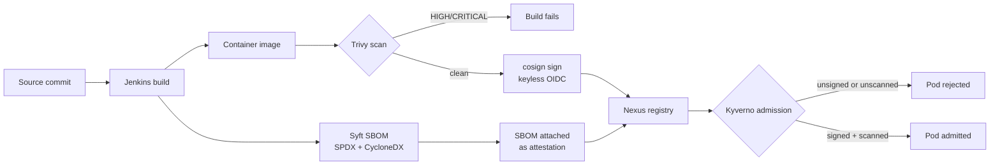
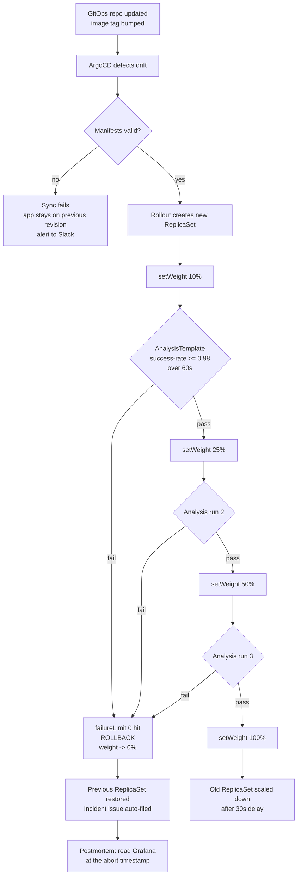
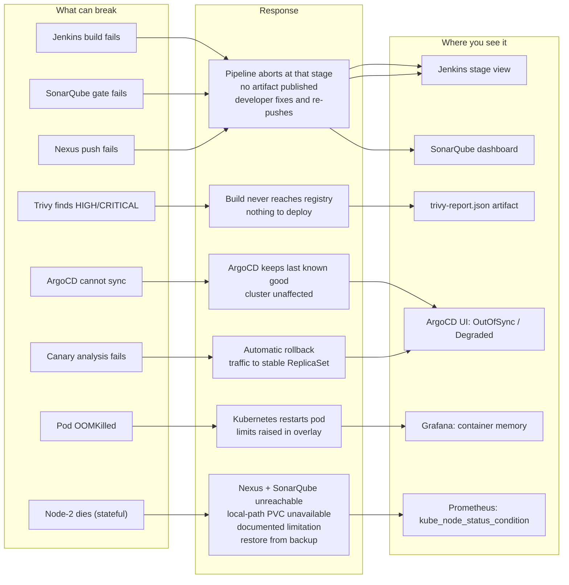

# ANOOS DevSecOps Pipeline

**A production-grade, security-hardened DevSecOps platform on 3 × EC2 instances running self-managed k3s — no EKS, no managed control plane, no one-click installer.**

> **Jenkins** (CI) · **Nexus** (artifacts + container registry) · **SonarQube** (code quality) · **Trivy** (vulnerability scanning) · **Kyverno** (admission policy) · **ArgoCD** (GitOps CD) · **Prometheus + Grafana + Loki** (observability) · **Terraform** (IaC) · **Spring Boot / Maven** (demo application)

The **pipeline is fully automated** — every push runs build → test → quality gate → scan → sign → publish → GitOps promotion with automatic rollback. The **platform install is deliberately manual**: every command is documented here so the cluster can be reproduced from bare instances, and so every component is understood rather than installed by a script that hides the machinery.

---

## Table of contents

- [Architecture](#architecture)
- [Node layout](#node-layout)
- [Phase 0 — Prerequisites](#phase-0--prerequisites)
- [Phase 1 — Provision infrastructure with Terraform](#phase-1--provision-infrastructure-with-terraform)
- [Phase 2 — Install k3s manually](#phase-2--install-k3s-manually)
- [Phase 3 — Cluster prerequisites (ingress, TLS, storage)](#phase-3--cluster-prerequisites)
- [Phase 4 — Platform services (Nexus, SonarQube, Jenkins)](#phase-4--platform-services)
- [Phase 5 — Observability stack](#phase-5--observability-stack)
- [Phase 6 — Security: Kyverno + Trivy Operator](#phase-6--security-kyverno--trivy-operator)
- [Phase 7 — Configure Nexus](#phase-7--configure-nexus)
- [Phase 8 — Configure SonarQube](#phase-8--configure-sonarqube)
- [Phase 9 — Configure Jenkins](#phase-9--configure-jenkins)
- [Phase 10 — GitOps with ArgoCD](#phase-10--gitops-with-argocd)
- [Phase 11 — End-to-end verification](#phase-11--end-to-end-verification)
- [Pipeline reference](#pipeline-reference)
- [Rollback drill](#rollback-drill)
- [Troubleshooting](#troubleshooting)
- [Teardown](#teardown)
- [Repository layout](#repository-layout)

---

## Architecture



### Request path



### Security trust chain



---

## Deployment and failure model

### Canary promotion decision tree



### Failure mode map




---

## Node layout

| Node | Instance | k3s role | Pinned workloads |
|---|---|---|---|
| **node-1** | m6i.xlarge (4 vCPU / 16 GB) | server (control plane) | ArgoCD, Traefik, cert-manager, Kyverno |
| **node-2** | m6i.xlarge (4 vCPU / 16 GB) | agent — stateful | Nexus, SonarQube + Postgres, local-path PVCs |
| **node-3** | m6i.xlarge (4 vCPU / 16 GB) | agent — CI + observability | Jenkins + ephemeral build pods, Prometheus, Grafana, Loki, Trivy Operator |

**Total: 12 vCPU / 48 GB / 300 GB gp3.**

Workloads are pinned with `nodeSelector` + tolerations so a Jenkins build storm on node-3 cannot starve SonarQube on node-2. Taints are applied in [Phase 2](#phase-2--install-k3s-manually).

### Why this shape

- **node-1 stays light** so `kubectl drain node-2` is a demoable operation — the node-failure drill in the troubleshooting section relies on it.
- **Stateful workloads are co-located** on node-2 with `local-path` volumes: no CSI driver, no cloud-volume dependency. A real deployment swaps in a CSI driver; that trade-off is documented in `docs/decisions.md`.
- **CI and observability share node-3** because Jenkins build pods are bursty while Prometheus/Grafana are steady — they interleave well.

---

## Phase 0 — Prerequisites

### Local tooling

```bash
# Terraform >= 1.6
terraform version

# AWS CLI v2, configured with credentials that can create VPC + EC2
aws --version
aws sts get-caller-identity

# kubectl (must be within one minor version of the cluster)
curl -LO "https://dl.k8s.io/release/$(curl -Ls https://dl.k8s.io/release/stable.txt)/bin/linux/amd64/kubectl"
chmod +x kubectl && sudo mv kubectl /usr/local/bin/

# Helm 3.x
curl -fsSL https://raw.githubusercontent.com/helm/helm/main/scripts/get-helm-3 | bash

# kustomize (optional; kubectl has it built in)
curl -sSL https://github.com/kubernetes-sigs/kustomize/releases/latest/download/kustomize_v5.5.0_linux_amd64.tar.gz | tar xz
sudo mv kustomize /usr/local/bin/

# k9s (optional but recommended)
curl -sS https://github.com/derailed/k9s/releases/latest/download/k9s_Linux_amd64.tar.gz | tar xz
sudo mv k9s /usr/local/bin/
```

### EC2 key pair

```bash
aws ec2 create-key-pair \
  --key-name anoos-key \
  --query 'KeyMaterial' \
  --output text > ~/.ssh/anoos-key.pem

chmod 600 ~/.ssh/anoos-key.pem
```

Verify the key is usable:

```bash
aws ec2 describe-key-pairs --key-names anoos-key --query 'KeyPairs[0].KeyName'
# expected: "anoos-key"
```

### Terraform variables

```bash
cd terraform/

cat > terraform.tfvars <<'EOF'
region       = "us-east-1"
project_name = "anoos"
key_name     = "anoos-key"
instance_type = "m6i.xlarge"
EOF
```

> **Restrict the admin CIDR.** `modules/network` defaults `admin_cidr` to `0.0.0.0/0` so the runbook works out of the box. Before you leave the cluster running, set it to your own IP:
> ```bash
> echo 'admin_cidr = "'$(curl -s https://checkip.amazonaws.com)'/32"' >> terraform.tfvars
> ```

---

## Phase 1 — Provision infrastructure with Terraform

```bash
cd terraform/
terraform init
terraform fmt -check -recursive   # must exit 0
terraform validate                # must print: Success! The configuration is valid.
terraform plan -out=tfplan
```

The plan should show **13 resources**:

| Resource | Count | Purpose |
|---|---|---|
| `aws_vpc.main` | 1 | Isolated network |
| `aws_subnet.main` | 1 | Public subnet |
| `aws_internet_gateway.gw` | 1 | Outbound internet |
| `aws_route_table.rt` + association | 2 | Default route |
| `aws_security_group.nodes` | 1 | Node traffic |
| `aws_security_group_rule.*` | 10 | SSH, HTTP, HTTPS, 6443, 8472 ×2, 10250, 2379-2380, 30000-32767, egress |
| `aws_instance.node` | 3 | The three nodes |
| `aws_eip.node` | 3 | Stable public IPs |

```bash
terraform apply tfplan
```

Expected output:

```
node_ips           = ["54.x.x.11", "54.x.x.12", "54.x.x.13"]
node_private_ips   = ["10.42.0.21", "10.42.0.22", "10.42.0.23"]
ssh_commands       = ["ssh ubuntu@54.x.x.11", ...]
```

**Record the outputs** — node-1 is the first IP (k3s server), nodes 2 and 3 are agents:

```bash
terraform output -raw node_ips
```

Verify all three respond:

```bash
for ip in $(terraform output -json node_ips | jq -r '.[]'); do
  echo -n "$ip: "
  ssh -o StrictHostKeyChecking=no -o ConnectTimeout=5 ubuntu@$ip 'hostname && nproc && free -g | head -2' || echo "UNREACHABLE"
done
```

Expected: each prints `ip-10-42-0-xx`, `4` CPUs, ~16 GB RAM.

> **cloud-init only preps the OS** — swap off, `vm.max_map_count=262144` for SonarQube, and basic packages. It deliberately does **not** install k3s. That is Phase 2, by hand.

---

## Phase 2 — Install k3s manually

### 2.1 — Server on node-1

```bash
ssh ubuntu@NODE1_IP
```

```bash
# k3s server, single node bootstrap
curl -sfL https://get.k3s.io | INSTALL_K3S_VERSION=v1.31.3+k3s1 sh -s - server \
  --cluster-init \
  --write-kubeconfig-mode 644 \
  --disable traefik \
  --disable servicelb \
  --node-ip $(curl -s http://169.254.169.254/latest/meta-data/local-ipv4) \
  --tls-san $(curl -s http://169.254.169.254/latest/meta-data/public-ipv4) \
  --tls-san $(hostname -f)
```

`--cluster-init` enables embedded etcd (single-node HA-ready). `--disable traefik` because Traefik is installed separately in Phase 3 where its config is visible and versioned. `--disable servicelb` because Traefik uses a NodePort behind an ALB/SG rather than klipper.

Verify:

```bash
sudo systemctl status k3s --no-pager
sudo k3s kubectl get nodes
# expected: ip-10-42-0-21   Ready   control-plane,etcd,master   ...
```

### 2.2 — Join token and node IPs

```bash
sudo cat /var/lib/rancher/k3s/server/node-token
# expected: K10<hash>::server:<hash>   — copy this, it expires never but is secret

curl -s http://169.254.169.254/latest/meta-data/local-ipv4
# expected: 10.42.0.21  — the server's PRIVATE IP, used by agents
```

### 2.3 — Agents on node-2 and node-3

On **each** of node-2 and node-3:

```bash
ssh ubuntu@NODE2_IP     # then repeat on node-3

export K3S_URL=https://10.42.0.21:6443        # node-1 PRIVATE IP
export K3S_TOKEN=K10<hash>::server:<hash>      # from 2.2

curl -sfL https://get.k3s.io | INSTALL_K3S_VERSION=v1.31.3+k3s1 sh -s - agent \
  --node-ip $(curl -s http://169.254.169.254/latest/meta-data/local-ipv4)
```

Verify from node-1:

```bash
sudo -S -p '' k3s kubectl get nodes -o wide
# expected: 3 nodes, all Ready
```

### 2.4 — Kubeconfig on your workstation

```bash
# from your workstation
scp ubuntu@NODE1_IP:/etc/rancher/k3s/k3s.yaml ~/.kube/anoos.yaml
sed -i "s|127.0.0.1|NODE1_IP|g" ~/.kube/anoos.yaml
chmod 600 ~/.kube/anoos.yaml

export KUBECONFIG=~/.kube/anoos.yaml
echo 'export KUBECONFIG=~/.kube/anoos.yaml' >> ~/.bashrc

kubectl get nodes
kubectl get pods -A   # all kube-system pods Running
```

### 2.5 — Label and taint the nodes

This is what makes the pinning in Phase 4 work:

```bash
# node-2 holds stateful workloads
kubectl label node $(kubectl get nodes -o name | sed -n 2p) workload=stateful
kubectl taint  node $(kubectl get nodes -o name | sed -n 2p) workload=stateful:NoSchedule

# node-3 runs CI and observability
kubectl label node $(kubectl get nodes -o name | sed -n 3p) workload=ci
kubectl taint  node $(kubectl get nodes -o name | sed -n 3p) workload=ci:NoSchedule

# verify
kubectl get nodes --show-labels
kubectl describe node $(kubectl get nodes -o name | sed -n 2p) | grep -A2 Taints
```

> **Alternative:** k3s node names are derived from the EC2 hostname (`ip-10-42-0-22`). Substitute names explicitly if you prefer:
> ```bash
> kubectl label node ip-10-42-0-22 workload=stateful
> kubectl taint  node ip-10-42-0-22 workload=stateful:NoSchedule
> ```

---

## Phase 3 — Cluster prerequisites

### 3.1 — Traefik ingress

```bash
helm repo add traefik https://traefik.github.io/charts
helm repo update

helm install traefik traefik/traefik \
  --namespace kube-system \
  --set ingressClass.enabled=true \
  --set ingressClass.isDefaultClass=true \
  --set service.type=NodePort \
  --set service.nodePorts.web=30080 \
  --set service.nodePorts.websecure=30443
```

> **NodePort, not LoadBalancer.** There is no cloud controller manager on k3s EC2, so `LoadBalancer` would sit `<pending>` forever. Ports 30080/30443 are inside the 30000-32767 SG range opened in Phase 1.

Verify:

```bash
kubectl get pods -n kube-system -l app.kubernetes.io/name=traefik
kubectl get ingressclass
# expected: traefik   traefik.github.io/traefik   true
```

### 3.2 — cert-manager

```bash
helm repo add jetstack https://charts.jetstack.io
helm repo update

helm install cert-manager jetstack/cert-manager \
  --namespace cert-manager \
  --create-namespace \
  --set crds.enabled=true

kubectl get pods -n cert-manager
# expected: cert-manager, cainjector, webhook — all Running
```

Self-signed issuer for a local/dev cluster:

```bash
kubectl apply -f - <<'EOF'
apiVersion: cert-manager.io/v1
kind: ClusterIssuer
metadata:
  name: selfsigned
spec:
  selfSigned: {}
EOF

kubectl get clusterissuer
# expected: selfsigned   True   SelfSigned
```

> For real DNS, replace with a Let's Encrypt ACME ClusterIssuer. The prod overlay references `letsencrypt-prod` — create it before deploying to prod:
> ```bash
> kubectl apply -f - <<'EOF'
> apiVersion: cert-manager.io/v1
> kind: ClusterIssuer
> metadata:
>   name: letsencrypt-prod
> spec:
>   acme:
>     server: https://acme-v02.api.letsencrypt.org/directory
>     email: you@example.com
>     privateKeySecretRef:
>       name: letsencrypt-prod-account
>     solvers:
>       - http01:
>           ingress:
>             class: traefik
> EOF
> ```

### 3.3 — StorageClass check

k3s ships `local-path` as default. Confirm:

```bash
kubectl get storageclass
# expected: local-path (default)   rancher.io/local-path   Delete   WaitForFirstConsumer
```

PVCs in Phase 4 rely on this. Because it is `WaitForFirstConsumer`, a PVC bound to node-2 will only bind once a pod with the matching `nodeSelector` is scheduled.

### 3.4 — Namespaces

```bash
kubectl apply -f k8s/platform/namespaces.yaml
kubectl get ns | grep -E 'platform|observability|apps'
```

---

## Phase 4 — Platform services

Deploy Nexus, SonarQube, and Jenkins. All three are pinned to node-2 (stateful) or node-3 (CI) via `nodeSelector` + tolerations in the manifests.

```bash
kubectl apply -f k8s/platform/nexus.yaml
kubectl apply -f k8s/platform/sonarqube.yaml
kubectl apply -f k8s/platform/jenkins.yaml
```

Watch them come up (Nexus ~90 s, SonarQube ~2-3 min on first boot):

```bash
kubectl get pods -n platform -w
```

Expected:

```
nexus-0        1/1   Running   0   2m
postgres-0     1/1   Running   0   2m
sonarqube-0    1/1   Running   0   3m
jenkins-0      1/1   Running   0   90s
```

Verify each pod actually landed on the intended node:

```bash
kubectl get pods -n platform -o wide
# nexus-0, postgres-0, sonarqube-0  -> the node labelled workload=stateful
# jenkins-0                          -> the node labelled workload=ci
```

If a pod is `Pending`, check it is not trying to schedule on a tainted node without a matching toleration:

```bash
kubectl describe pod -n platform nexus-0 | grep -A5 Events
```

### 4.1 — Admin passwords

```bash
# Nexus initial admin password
kubectl exec -n platform nexus-0 -- cat /nexus-data/admin.password

# Jenkins initial admin password
kubectl exec -n platform jenkins-0 -- cat /var/jenkins_home/secrets/initialAdminPassword
```

SonarQube's default is `admin` / `admin` with a forced change on first login.

### 4.2 — Reach the UIs

The ingresses use `*.anoos.local` hostnames. On your workstation, map them to node-1's public IP:

```bash
NODE1=$(cd terraform && terraform output -raw node_ips | jq -r '.[0]')
echo "$NODE1 nexus.anoos.local nexus-docker.anoos.local sonar.anoos.local jenkins.anoos.local argocd.anoos.local grafana.anoos.local demo-api.anoos.local demo-api-staging.anoos.local" | sudo tee -a /etc/hosts
```

Because Traefik is on NodePort, forward locally:

```bash
# in a separate terminal, keep running
kubectl port-forward -n kube-system svc/traefik 8080:80 8443:443
```

Then browse `http://localhost:8080` with a `Host:` header — or use `curl`:

```bash
curl -H "Host: sonar.anoos.local" http://localhost:8080/api/system/status
# expected: {"status":"UP",...}
```

---

## Phase 5 — Observability stack

```bash
helm repo add prometheus-community https://prometheus-community.github.io/helm-charts
helm repo add grafana https://grafana.github.io/helm-charts
helm repo update
```

### 5.1 — Prometheus + Grafana + Alertmanager

```bash
helm install monitoring prometheus-community/kube-prometheus-stack \
  --namespace observability \
  --set prometheus.prometheusSpec.retention=15d \
  --set prometheus.prometheusSpec.resources.requests.memory=1Gi \
  --set prometheus.prometheusSpec.resources.limits.memory=3Gi \
  --set prometheus.prometheusSpec.nodeSelector.workload=ci \
  --set prometheus.prometheusSpec.tolerations[0].key=workload \
  --set prometheus.prometheusSpec.tolerations[0].operator=Equal \
  --set prometheus.prometheusSpec.tolerations[0].value=ci \
  --set prometheus.prometheusSpec.tolerations[0].effect=NoSchedule \
  --set grafana.adminPassword='ChangeMe123!' \
  --set grafana.nodeSelector.workload=ci \
  --set grafana.tolerations[0].key=workload \
  --set grafana.tolerations[0].operator=Equal \
  --set grafana.tolerations[0].value=ci \
  --set grafana.tolerations[0].effect=NoSchedule
```

Verify:

```bash
kubectl get pods -n observability
# expected: prometheus-monitoring-kube-prometheus-prometheus-0  Running
#           monitoring-grafana-*                                 Running
#           alertmanager-monitoring-*                            Running
```

```bash
kubectl port-forward -n observability svc/monitoring-grafana 3000:80
# browse http://localhost:3000  admin / ChangeMe123!
```

### 5.2 — Loki for logs

```bash
helm install loki grafana/loki-stack \
  --namespace observability \
  --set loki.persistence.enabled=true \
  --set loki.persistence.size=10Gi \
  --set loki.persistence.storageClassName=local-path \
  --set promtail.enabled=true \
  --set grafana.enabled=false
```

Verify log flow:

```bash
kubectl get pods -n observability -l app=loki
kubectl get ds -n observability promtail
# expected: promtail DaemonSet DESIRED 3  READY 3
```

In Grafana: **Connections → Data sources → Add → Loki**, URL `http://loki:3100`, then **Explore** and query `{namespace="apps-staging"}`.

### 5.3 — Verify metrics are actually flowing

```bash
kubectl port-forward -n observability svc/monitoring-kube-prometheus-prometheus 9090:9090
# browse http://localhost:9090 → Status → Targets
# expected: kubelet, node-exporter, kube-state-metrics, apiserver — all UP
```

Query to confirm cluster metrics:

```
sum(node_memory_MemAvailable_bytes) / sum(node_memory_MemTotal_bytes) * 100
```

---

## Phase 6 — Security: Kyverno + Trivy Operator

### 6.1 — Kyverno

```bash
helm repo add kyverno https://kyverno.github.io/kyverno
helm repo update

helm install kyverno kyverno/kyverno \
  --namespace kyverno \
  --create-namespace

kubectl get pods -n kyverno
# expected: kyverno-admission-controller, background-controller, cleanup-controller, reports-controller
```

Apply the policies:

```bash
kubectl apply -f k8s/security/kyverno-policies.yaml
kubectl get clusterpolicy
```

### 6.2 — Trivy Operator

```bash
helm repo add aqua https://aquasecurity.github.io/helm-charts
helm repo update

helm install trivy-operator aqua/trivy-operator \
  --namespace trivy-system \
  --create-namespace \
  --set trivy.ignoreUnfixed=true \
  --set operator.scanJobCompressLogs=true

kubectl get pods -n trivy-system
# expected: trivy-operator-*  Running
```

Verify it is scanning:

```bash
kubectl get vulnerabilityreports -A
# expected: one report per pod, eventually

kubectl get clustercompliancereports -A
```

---

## Phase 7 — Configure Nexus

1. Open `http://localhost:8080` with `Host: nexus.anoos.local` (or the mapped hostname).
2. Log in as `admin` with the password from Phase 4.1. Complete the setup wizard, set a new password.
3. **Create the Maven hosted repository** (for JARs):

   **Settings → Repositories → Create repository → maven2 (hosted)**
   | Field | Value |
   |---|---|
   | Name | `demo-apps` |
   | Version policy | Release |
   | Deployment policy | Allow redeploy |
   | Layout policy | Strict |

4. **Create the Docker hosted repository** (for images):

   **Settings → Repositories → Create repository → docker (hosted)**
   | Field | Value |
   |---|---|
   | Name | `demo-images` |
   | HTTP port | `8082` |
   | Enable Docker V1 API | yes |
   | Allow anonymous docker pull | no |

5. **Allow HTTP (not HTTPS) for the Docker connector** — required because the connector sits behind Traefik without TLS:

   **Settings → Security → Realms** — ensure `Docker Bearer Token Realm` is **Active**.

   **Settings → System → Capabilities → Docker** — no change needed if port 8082 was set above.

6. **Create a CI user** (do not use `admin` in pipelines):

   **Settings → Security → Users → Create local user**
   | Field | Value |
   |---|---|
   | ID | `jenkins-ci` |
   | Password | (strong, record it) |
   | Status | Active |

   Then **Roles → Create role** named `ci-deployer` with privileges `nx-repository-view-*-*-*` and `nx-repository-admin-*-*-*`, and assign it to `jenkins-ci`.

7. **Verify from your workstation:**

   ```bash
   # Maven repo reachable
   curl -u jenkins-ci:PASSWORD -s -o /dev/null -w "%{http_code}\n" \
     http://localhost:8080/repository/demo-apps/
   # expected: 200

   # Docker repo responds to the v2 API
   curl -s -o /dev/null -w "%{http_code}\n" -H "Host: nexus-docker.anoos.local" \
     http://localhost:8080/v2/
   # expected: 401 (auth required - correct) or 200 once authenticated
   ```

8. **Docker daemon trust** — Nexus on plain HTTP must be listed as an insecure registry on every node that builds or pulls:

   ```bash
   # on node-3 (the build node)
   ssh ubuntu@NODE3_IP
   sudo tee /etc/docker/daemon.json <<'EOF'
   {
     "insecure-registries": ["nexus-docker.anoos.local:8082", "localhost:8082"]
   }
   EOF
   sudo systemctl restart docker
   ```

---

## Phase 8 — Configure SonarQube

1. Browse to SonarQube, log in `admin`/`admin`, change the password.
2. **Create the project:** Projects → Create project → Manually → Key `demo-api`, name `Demo API`.
3. **Generate a token:** My Account → Security → Generate token, name `jenkins`, type *Project Analysis Token* scoped to `demo-api`. Copy it.
4. **Create the quality gate** (or use the built-in *Sonar way*): Quality Gates → Sonar way → confirm conditions include coverage ≥ 80% on new code and 0 new blocker issues.
5. Verify the API is reachable from the cluster:

   ```bash
   kubectl run -n platform curl-test --rm -it --restart=Never --image=curlimages/curl -- \
     curl -s http://sonarqube:9000/api/system/status
   # expected: {"status":"UP",...}
   ```

---

## Phase 9 — Configure Jenkins

### 9.1 — Initial setup

1. Browse to Jenkins, unlock with the password from Phase 4.1.
2. Install **suggested plugins**, then add these explicitly (Manage Jenkins → Plugins):
   - `Kubernetes` + `Kubernetes CLI`
   - `SonarQube Scanner`
   - `Pipeline: Stage View`
   - `Git` + `GitHub`
   - `Credentials Binding`
   - `JUnit`
3. Restart Jenkins after plugin install.

### 9.2 — Kubernetes cloud

**Manage Jenkins → Clouds → New cloud → Kubernetes**

| Field | Value |
|---|---|
| Name | `kubernetes` |
| Kubernetes URL | `https://kubernetes.default.svc` |
| Kubernetes Namespace | `platform` |
| Credentials | (empty — the pod's ServiceAccount is used) |
| Jenkins URL | `http://jenkins.platform.svc.cluster.local:8080` |
| WebSocket | enabled |

**Test Connection** must report success. The `jenkins` ServiceAccount already has `cluster-admin` via `k8s/platform/jenkins.yaml`.

### 9.3 — Credentials

**Manage Jenkins → Credentials → System → Global credentials**

| ID | Kind | Value | Used by |
|---|---|---|---|
| `nexus-credentials` | Username with password | `jenkins-ci` / its password | Docker push, Maven deploy |
| `sonar-token` | Secret text | SonarQube token from Phase 8 | `withSonarQubeEnv` |
| `github-credentials` | Username with password | `<username>` / PAT with `repo` scope | GitOps manifest bump |
| `argocd-token` | Secret text | ArgoCD API token (Phase 10.3) | Optional rollback step |

### 9.4 — Tool configuration

**Manage Jenkins → Tools**

| Tool | Config |
|---|---|
| SonarQube Scanner | Name `sonar-scanner`, install automatically |
| Maven | Name `maven3`, version 3.9.x, install automatically |
| JDK | Name `jdk21`, version 21, install automatically |

### 9.5 — SonarQube server

**Manage Jenkins → System → SonarQube servers → Add SonarQube**

| Field | Value |
|---|---|
| Name | `sonarqube` (must match `withSonarQubeEnv('sonarqube')`) |
| Server URL | `http://sonarqube.platform.svc.cluster.local:9000` |
| Server authentication token | `sonar-token` |

### 9.6 — The Maven cache PVC

The Jenkinsfile mounts `maven-cache-pvc` so builds reuse `~/.m2`:

```bash
kubectl apply -f - <<'EOF'
apiVersion: v1
kind: PersistentVolumeClaim
metadata:
  name: maven-cache-pvc
  namespace: platform
spec:
  accessModes: [ReadWriteMany]
  resources:
    requests:
      storage: 5Gi
  storageClassName: local-path
EOF
```

> `local-path` is **ReadWriteOnce**, not `ReadWriteMany`. A single build at a time works; concurrent builds will fail to mount. Either set `--set controller.maxConcurrentBuilds=1` or install an RWX-capable provisioner (NFS subdir provisioner is the usual choice). This is called out deliberately rather than hidden.

### 9.7 — Create the pipeline job

**New Item → Pipeline → name `demo-api`**

- Definition: *Pipeline script from SCM*
- SCM: Git, URL `https://github.com/muhammedhanas/anoos-devsecops-pipeline.git`
- Branch: `*/master`
- Script Path: `jenkins/Jenkinsfile`

Save, then **Build with Parameters** (after the first run registers parameters) or **Build Now**.

---

## Phase 10 — GitOps with ArgoCD

### 10.1 — Install ArgoCD

```bash
helm repo add argo https://argoproj.github.io/argo-helm
helm repo update

helm install argocd argo/argo-cd \
  --namespace argocd \
  --create-namespace \
  --set configs.params."server\.insecure"=true \
  --set server.ingress.enabled=true \
  --set server.ingress.hostname=argocd.anoos.local \
  --set server.ingress.ingressClassName=traefik

kubectl get pods -n argocd
# expected: argocd-server, argocd-repo-server, argocd-application-controller,
#           argocd-applicationset-controller, argocd-redis, argocd-dex-server
```

### 10.2 — Admin password

```bash
kubectl -n argocd get secret argocd-initial-admin-secret \
  -o jsonpath="{.data.password}" | base64 -d; echo
```

Log in as `admin` at the ArgoCD hostname.

### 10.3 — API token (for the pipeline)

```bash
argocd login argocd.anoos.local --username admin --password '<password>'
argocd account generate-token --account admin
# store this in Jenkins as argocd-token
```

### 10.4 — Register the applications

Edit `k8s/app/argocd-application.yaml` — it ships with the correct repo URL, but confirm `repoURL` matches your fork if you have one — then:

```bash
kubectl apply -f k8s/app/argocd-application.yaml
```

Verify:

```bash
argocd app list
# expected: demo-api-staging   Synced   Healthy

argocd app get demo-api-staging
```

Watch it sync:

```bash
argocd app sync demo-api-staging
argocd app wait demo-api-staging --health
```

Add the prod application once staging is healthy:

```bash
cp k8s/app/argocd-application.yaml k8s/app/argocd-application-prod.yaml
sed -i 's/demo-api-staging/demo-api-prod/; s|overlays/staging|overlays/prod|' k8s/app/argocd-application-prod.yaml
kubectl apply -f k8s/app/argocd-application-prod.yaml
```

### 10.5 — Confirm GitOps actually reconciles

Deliberately break it and watch ArgoCD fix it:

```bash
kubectl scale rollout -n apps-staging demo-api --replicas=5
sleep 20
kubectl get rollout -n apps-staging demo-api -o jsonpath='{.spec.replicas}'
# expected: 1   — ArgoCD selfHeal reverted the manual change
```

---


### 10.5 — Argo Rollouts (canary deployment controller)

The `Rollout` resource in `k8s/app/rollout.yaml` replaces a plain Deployment so the canary strategy in the architecture diagram is real. It needs the Rollouts controller:

```bash
helm repo add argo https://argoproj.github.io/argo-helm
helm repo update

helm install argo-rollouts argo/argo-rollouts \
  --namespace argo-rollouts \
  --create-namespace

kubectl get pods -n argo-rollouts
# expected: argo-rollouts-*  Running
```

Install the kubectl plugin for `get rollout` / `promote`:

```bash
curl -LO https://github.com/argoproj/argo-rollouts/releases/latest/download/kubectl-argo-rollouts-linux-amd64
chmod +x kubectl-argo-rollouts-linux-amd64
sudo mv kubectl-argo-rollouts-linux-amd64 /usr/local/bin/kubectl-argo-rollouts

kubectl argo rollouts version
```

Verify the rollout is healthy:

```bash
kubectl argo rollouts get rollout demo-api -n apps-staging --watch
```

**Watch a canary progress.** Change the image tag in the GitOps repo and let ArgoCD sync:

```bash
kubectl argo rollouts get rollout demo-api -n apps-staging --watch
# expected sequence:
#   SetWeight 10  -> Pause 60s -> Analysis success-rate Running
#   SetWeight 25  -> Pause 60s -> Analysis success-rate Running
#   SetWeight 50  -> Pause 60s -> SetWeight 100
```

**Watch it abort.** Push a tag whose pods fail readiness (or stop the app), and the AnalysisTemplate fails at `failureLimit: 0`:

```bash
kubectl argo rollouts get rollout demo-api -n apps-staging --watch
# expected: AnalysisRun Failed -> Rollout Degraded -> traffic back to stable at 100%
kubectl argo rollouts abort demo-api -n apps-staging      # manual abort if needed
kubectl argo rollouts undo  demo-api -n apps-staging       # full rollback
```

The `AnalysisTemplate` queries Prometheus for the 5xx-free request ratio over a 1-minute window and requires ≥ 0.98. One failure aborts the rollout immediately.

## Phase 11 — End-to-end verification

Run these in order. Each has an expected result — if one fails, stop and fix it before continuing.

### 11.1 — Push a change and watch the pipeline

```bash
git clone https://github.com/muhammedhanas/anoos-devsecops-pipeline.git
cd anoos-devsecops-pipeline

# make a trivial change to the app
sed -i 's/Hello from ANOOS demo-api/Hello from ANOOS demo-api v2/' \
  apps/demo-api/src/main/java/com/anoos/demoapi/DemoApplication.java

git add -A && git commit -m "feat: update greeting" && git push
```

Expected in Jenkins: 9 stages green, `trivy-report.json` archived, JAR in Nexus, image tag bumped in Git.

### 11.2 — Verify each artifact independently

```bash
# 1. JAR landed in Nexus
curl -u jenkins-ci:PASS -s http://localhost:8080/repository/demo-apps/com/anoos/demo-api/ \
  -H "Host: nexus.anoos.local" | head

# 2. Image landed in Nexus docker repo
curl -s -u jenkins-ci:PASS -H "Host: nexus-docker.anoos.local" \
  http://localhost:8080/v2/demo-api/tags/list
# expected: {"name":"demo-api","tags":["master-42",...]}

# 3. SonarQube analysis exists
curl -s -u TOKEN: http://localhost:8080/api/measures/component?component=demo-api\&metricKeys=coverage \
  -H "Host: sonar.anoos.local"
# expected: {"component":{"measures":[{"metric":"coverage","value":"..."}]}}

# 4. ArgoCD picked up the new tag
argocd app get demo-api-staging -o json | jq '.status.sync.revision'
```

### 11.3 — Verify the app is serving

```bash
kubectl argo rollouts get rollout demo-api -n apps-staging
kubectl get pods -n apps-staging -o wide
kubectl logs -n apps-staging -l app=demo-api --tail=20

curl -H "Host: demo-api-staging.anoos.local" http://localhost:8080/api/hello
# expected: {"message":"Hello from ANOOS demo-api"}
```

### 11.4 — Verify observability sees it

```bash
# Prometheus has the app's metrics
kubectl port-forward -n observability svc/monitoring-kube-prometheus-prometheus 9090:9090 &
curl -s 'http://localhost:9090/api/v1/query?query=up{namespace="apps-staging"}' | jq '.data.result | length'
# expected: >= 1

# Loki has its logs
kubectl port-forward -n observability svc/loki 3100:3100 &
curl -s "http://localhost:3100/loki/api/v1/query_range?query={namespace="apps-staging"}&limit=5" | jq '.data.result | length'
# expected: >= 1
```

### 11.5 — Verify security controls actually block

Prove the Kyverno policy is not decorative:

```bash
# Try to run an image that has no scan report and is unsigned
kubectl run policy-test -n apps-staging --image=nginx:latest
# expected: Error from server: admission webhook "validate.kyverno.svc-fail" denied the request
```

Prove Trivy is scanning:

```bash
kubectl get vulnerabilityreports -A -o custom-columns='NS:.metadata.namespace,POD:.metadata.labels.trivy-operator\.resource-name,CRIT:.report.summary.criticalCount,HIGH:.report.summary.highCount'
```

---

## Pipeline reference

`jenkins/Jenkinsfile` — declarative, runs on ephemeral Kubernetes pods.

| # | Stage | Tool | Gate | Artifact produced |
|---|---|---|---|---|
| 1 | Checkout | git | — | workspace |
| 2 | Build + test | Maven 3.9 / JDK 21 | any test failure aborts | `target/*.jar`, JUnit XML |
| 3 | Static analysis | SonarQube | — | analysis report |
| 4 | **Quality gate** | SonarQube | `abortPipeline: true` on gate failure | — |
| 5 | Image build | Docker (dind) | build failure aborts | `demo-api:<branch>-<build>` |
| 6 | **Vulnerability scan** | Trivy | `--exit-code 1 --severity HIGH,CRITICAL` | `trivy-report.json` |
| 7 | Publish image | Docker login to Nexus | push failure aborts | image in Nexus |
| 8 | Publish JAR | `mvn deploy` | upload failure aborts | artifact in Nexus |
| 9 | GitOps bump | git | commit failure aborts | updated manifest -> ArgoCD -> canary rollout |

**Agent pod** — `maven`, `trivy`, and `docker:dind` containers share one pod per build; nothing is installed on node-3's host OS. Build pods tolerate the `workload=ci` taint.

---

## Rollback drill

Three ways, from fastest to most representative.

### 1 — ArgoCD rollback (seconds)

```bash
argocd app history demo-api-staging
argocd app rollback demo-api-staging <deploy-id>
argocd app wait demo-api-staging --health
```

### 2 — Git revert (the GitOps way, what you would do in a real incident)

```bash
git revert HEAD --no-edit
git push
# ArgoCD picks up the revert within ~3 minutes
watch kubectl get pods -n apps-staging
```

### 3 — Argo Rollouts undo (Kubernetes-native)

```bash
kubectl argo rollouts list rollouts -n apps-staging
kubectl argo rollouts undo demo-api -n apps-staging
kubectl argo rollouts status demo-api -n apps-staging
```

> ArgoCD will fight a manual `rollout undo` because `selfHeal: true`. Use method 1 or 2 on a GitOps-managed app; method 3 is what you would use on a non-GitOps workload and is included because interviewers ask about both.

---

## Troubleshooting

| Symptom | Cause | Fix |
|---|---|---|
| Pod `Pending`, event `had taint {workload: stateful}` | no toleration on the workload | add `nodeSelector` + `tolerations` matching the taint, or re-label the node |
| PVC stuck `Pending` | `local-path` uses `WaitForFirstConsumer` | schedule a pod that mounts it; it binds on scheduling |
| Ingress 404 | wrong `ingressClassName` or Traefik not the default class | `kubectl get ingressclass`; add `ingressClassName: traefik` |
| Ingress 503 | Service selector mismatch or pod not Ready | `kubectl get endpoints -n <ns> <svc>` — empty means no matching pods |
| `docker login` to Nexus fails | daemon not configured for an insecure registry | add to `insecure-registries` in `/etc/docker/daemon.json`, restart docker |
| Jenkins build pod stuck `ContainerCreating` | cannot mount `maven-cache-pvc` on a different node | RWO limit — run one build at a time, or use an RWX provisioner |
| SonarQube exits with `max virtual memory areas too low` | `vm.max_map_count` not set | the cloud-init in Terraform sets it; confirm with `sysctl vm.max_map_count` (262144) |
| SonarQube pod `OOMKilled` | limit too low, or scheduled on a busy node | raise to 4Gi; confirm it is on node-2 |
| Trivy scan cannot pull image | image is in Nexus over HTTP, Trivy needs `--insecure` | add `--insecure` to the Trivy stage, or put TLS in front of Nexus |
| ArgoCD `ComparisonError` | repo unreachable or path wrong | `argocd app get <app>` → check repo URL and `path` |
| `terraform apply` fails on `aws_eip` | account limit or the instance is still pending | retry; check `aws ec2 describe-addresses` |
| Nodes show `NotReady` after reboot | k3s service not enabled | `sudo systemctl enable --now k3s` (server) or `k3s-agent` |

### Node failure drill

```bash
# drain node-2 — stateful pods will not reschedule (local-path RWO)
kubectl drain <node-2> --ignore-daemonsets --delete-emptydir-data

kubectl get pods -n platform -o wide
# nexus-0, sonarqube-0, postgres-0 -> Pending or Terminating
# this is the documented limitation of local-path, not a bug

kubectl uncordon <node-2>
# pods reschedule back and PVCs rebind
```

This drill is worth running once and writing up — it demonstrates you understand why `local-path` is not production storage.

---

## Teardown

```bash
cd terraform/
terraform destroy
```

Confirm nothing is left billing:

```bash
aws ec2 describe-instances --filters "Name=tag:Project,Values=anoos" \
  "Name=instance-state-name,Values=running" --query 'Reservations[].Instances[].InstanceId'
# expected: []
```

---

## Repository layout

```
.
├── README.md                          # this runbook
├── .env.example                       # every variable the platform needs
├── docs/
│   └── decisions.md                   # 5 ADRs: k3s vs EKS, Nexus vs ECR, Jenkins vs GHA, ArgoCD vs Flux, local-path vs EBS
├── terraform/
│   ├── main.tf                        # provider + module wiring
│   ├── variables.tf
│   ├── outputs.tf
│   └── modules/
│       ├── network/                   # VPC, subnet, IGW, routes, SG + 10 rules
│       └── instances/                 # 3x EC2, EIPs, cloud-init (OS prep only)
├── jenkins/
│   └── Jenkinsfile                    # 9-stage pipeline on ephemeral k8s agents
├── k8s/
│   ├── app/                           # kustomize base
│   │   ├── kustomization.yaml
│   │   ├── rollout.yaml               # Argo Rollout: canary 10->25->50->100 + analysis
│   │   ├── analysistemplate.yaml       # Prometheus success-rate gate, failureLimit 0
│   │   ├── deployment.yaml            # Services (stable/canary/weighted) + Ingress
│   │   └── argocd-application.yaml    # ArgoCD Application (staging)
│   ├── overlays/
│   │   ├── staging/                   # 1 replica, staging hostname
│   │   └── prod/                      # 3 replicas, letsencrypt-prod issuer
│   ├── platform/                      # Nexus, SonarQube+Postgres, Jenkins, namespaces
│   └── security/
│       └── kyverno-policies.yaml      # require signed + scanned images, no :latest
└── apps/
    └── demo-api/                      # Spring Boot 3.3.4, Java 21, Maven
        ├── pom.xml
        ├── Dockerfile                 # multi-stage, non-root, healthcheck
        └── src/{main,test}/...
```

---

## License

MIT
